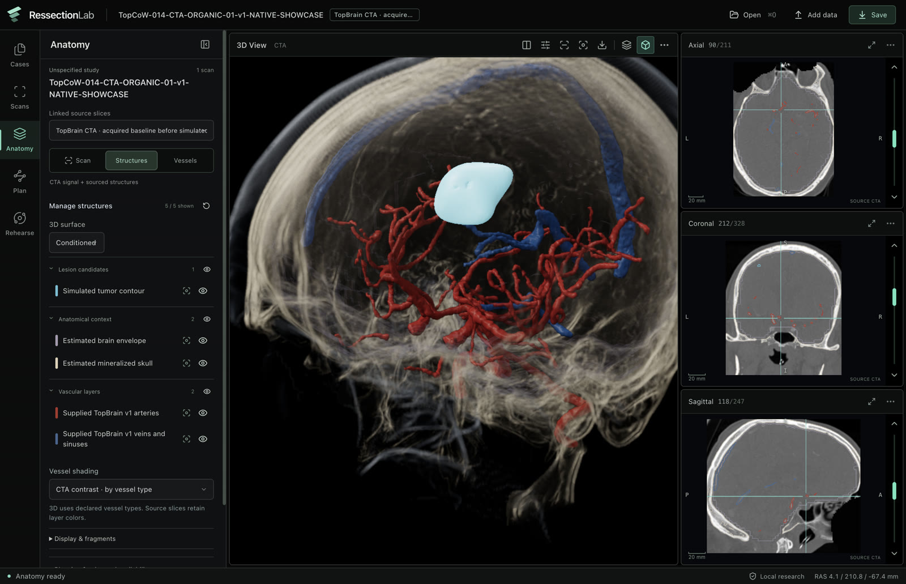
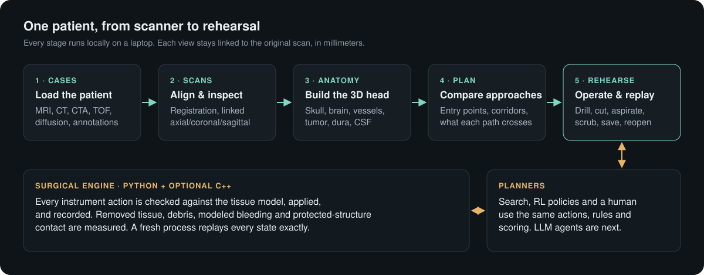
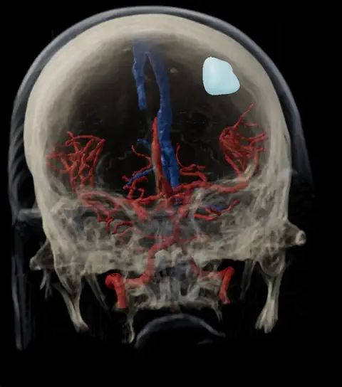
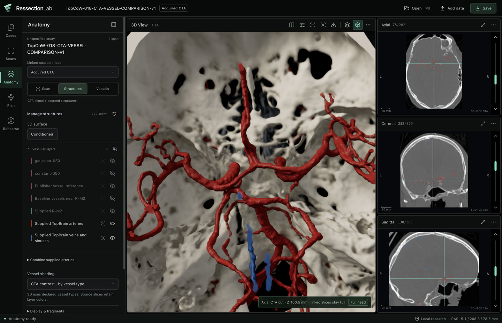
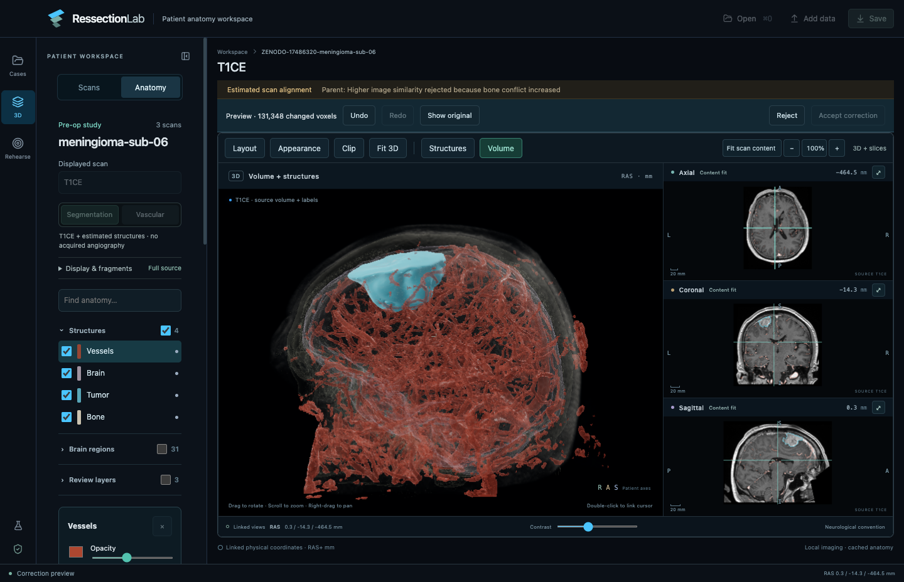
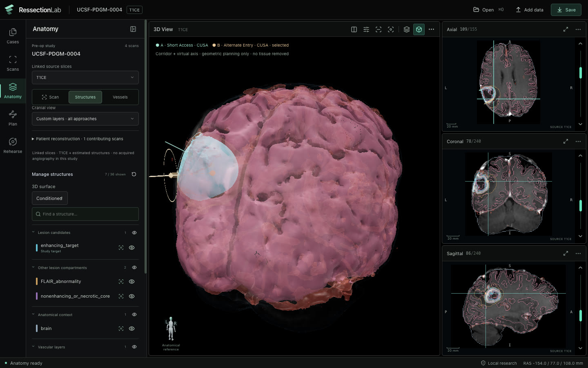
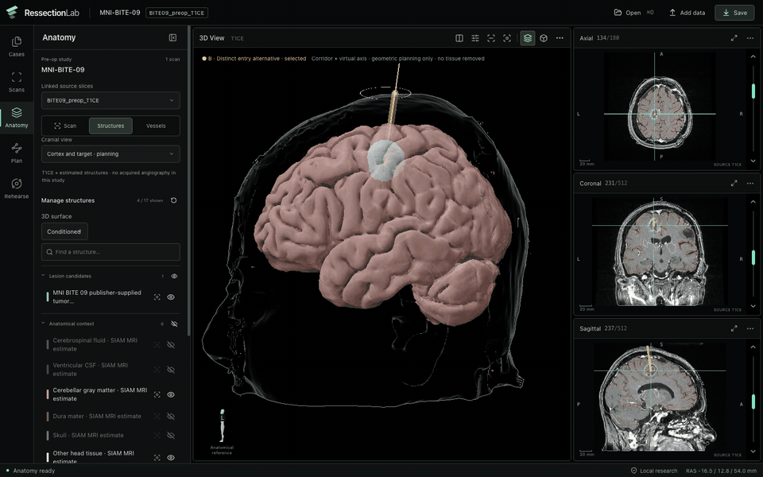
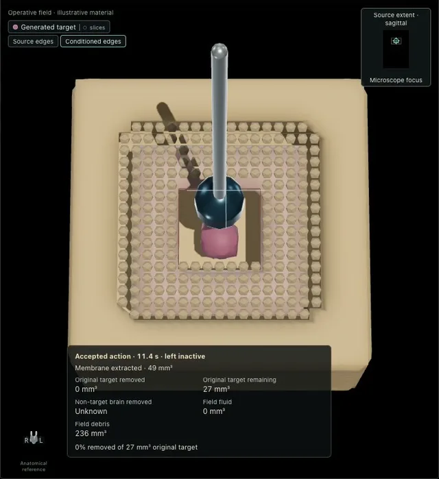

<h1 align="center">RessectionLab</h1>

<p align="center">
  <b>A flight simulator for brain surgery, built from a real patient's scans.</b><br>
  Load the MRI and CT. Get a 3D head with skull, brain, vessels and tumor.<br>
  Plan the approach, then rehearse the operation step by step and replay it frame for frame.
</p>

<p align="center">
  
</p>
<p align="center"><sub>A public CT angiogram (TopCoW 014) in the desktop app: arteries in red, veins and sinuses in blue from the dataset's own vessel labels, and a simulated tumor added for practice. The three slice views on the right stay linked to the same point in the head.</sub></p>

---

## Why this exists

Before a neurosurgeon removes a tumor, they study the scans and decide how to get
there: where to open the skull, which path to take through the brain, and which
vessels and functional areas to protect along the way. Today most of that
reasoning happens in the surgeon's head, looking at flat slices.

RessectionLab turns those scans into a 3D environment where an approach can be
**seen, compared, executed and measured** before anyone touches a patient. A
person can practice in it, and so can software. The long-term goal is to put an
AI agent in the surgeon's shoes: give it the patient's anatomy, a set of real
instruments and the rules of the operating room, and see whether it can plan and
carry out a resection that removes the tumor while sparing the brain around it.

> **Research software.** RessectionLab is an experimental research platform. It is
> not a medical device, it has not been clinically validated, and it must not be
> used to make decisions about real patients.

## What it does

<p align="center">
  
</p>

### 1. Turns scans into a 3D patient

<table>
<tr>
<td width="44%"></td>
<td>

Drop in a study (MRI, CT, CT angiography, TOF angiography, diffusion) and the app
lines the scans up in one physical frame, measured in millimeters. It then builds
the anatomy a surgeon cares about: skull, brain surface, dura, cerebrospinal
fluid, arteries, veins and the tumor.

Every 3D surface stays tied to the original slices. Click anywhere in the head
and the axial, coronal and sagittal views jump to that exact point, so you can
always check the 3D model against what the scanner actually saw.

Where a structure comes from a model estimate rather than the patient's own
labels, the app says so. Missing evidence is shown as missing, never quietly
treated as safe.

</td>
</tr>
</table>

<p align="center">
  
  
</p>
<p align="center"><sub>Left: looking up from the skull base of a public CTA (TopCoW 018) at the circle of Willis, the ring of arteries that feeds the brain. Right: a public meningioma MRI with an estimated vessel network and the tumor in blue.</sub></p>

### 2. Plans and compares approaches

Pick a target and the planner proposes several ways in. For each corridor it
reports how long the path is, how close it comes to protected structures and how
much healthy tissue lies in the way, so two approaches can be compared side by
side instead of argued about.

<p align="center">
  
</p>
<p align="center"><sub>Two candidate aspirator approaches (short access and alternate entry) to a glioma in a public MRI (UCSF-PDGM 0004). The slices show the tumor outline on the patient's own scan.</sub></p>

### 3. Rehearses the operation

This is where RessectionLab differs from a viewer. The selected approach can be
played out as an operation: lift the bone flap, open the dura, retract, and
advance an ultrasonic aspirator into the tumor. A timeline lets you scrub back and
forth through every step.

<p align="center">
  
</p>
<p align="center"><sub>One public MRI (MNI BITE 09) from anatomy to plan to opening and aspiration. This walkthrough is a geometric illustration on estimated tissue labels, not a physical simulation of the patient.</sub></p>

Behind the rehearsal sits a **surgical engine**. Every instrument action, from
placing a tool to applying suction, is checked against the tissue model and then
recorded. It measures how much tumor was removed, how much healthy tissue was
lost, how much debris and fluid are in the field, and whether a protected
structure was touched. Unsafe requests are refused. A saved session can be closed,
reopened in a fresh process, and replayed to exactly the same state.

<table>
<tr>
<td width="44%"></td>
<td>

You can also take the controls. From any verified point in a recording, start a
practice session and drive the instruments with mouse and keyboard. Each move
is sent to the engine, accepted or refused, and shown within about a tenth of a
second on a laptop.

In the clip, an operator works in a generated training model: the aspirator
enters through the opening and takes a first bite of the target, a tool exchange
is refused while the instrument is still inside, suction clears debris and both tools withdraw.
The session then reopens from disk exactly as it was left.

The engine also models soft-tissue retraction and recoil, cut vessels that bleed
until they are sealed with bipolar cautery, irrigation and suction.

</td>
</tr>
</table>

### 4. Lets AI plan, act and be measured

The same actions, rules and scoring are exposed to software planners. Search
algorithms and reinforcement-learning policies have already been compared head
to head on held-out generated procedures, from treatment through debris cleanup
and withdrawal of both instruments. Because the engine records everything,
every decision can be replayed and audited.

Next up is giving large language model agents the same toolbox: anatomical
context, instruments, risk maps and the simulator, so they can propose a strategy,
execute it, see what happened, and revise. The aim is a reproducible benchmark
for AI surgical planning.

## Under the hood

| Part | What it is |
| --- | --- |
| Desktop app | Electron, React and TypeScript, with a Three.js volume and surface renderer |
| Engine | Python surgical engine with an optional C++ (pybind11) backend, plus opt-in accelerated paths (`RESECTIONLAB_ACCEL`) that speed up tissue mechanics, contact and cutting kernels by roughly 2× to over 20× in Linux benchmarks, each checked against the reference implementation |
| Imaging | Scan intake, registration, brain extraction, vessel and tumor reconstruction |
| Planning | Route generation, approach comparison, search and reinforcement-learning planners |
| Data | Public research datasets such as UCSF-PDGM, BraTS, TopCoW/TopBrain, MNI BITE, IXI, ReMIND, RESECT and the EDEN2020 synthetic cohort |
| Testing | Hundreds of Python tests, over a thousand desktop tests, and hidden-window checks of the real app |

Everything runs locally. No cloud service or paid infrastructure is needed, and
no patient data is stored in this repository.

## Being honest about where it stands

This project tries hard not to overclaim, and the README shouldn't either.

- The tissue mechanics are research models. They are not calibrated against
  real brain tissue, so measured removal and deformation describe the simulator,
  not a patient.
- Many anatomical structures come from automated estimates rather than expert
  labels, and the app marks which is which.
- No real patient case has yet qualified for a complete simulated procedure from
  opening to withdrawal. Full procedures so far run on generated cases; real scans are
  used for reconstruction, planning and illustrated rehearsal.
- Neurological outcomes (for example, risk of weakness or speech loss) are not
  predicted. Where functional or vascular data is missing, risk is reported as
  unknown.

## Evidence and interpretation

Source images, supplied annotations, model estimates, population atlases and
simulator-generated experience are kept separate, and every result says which it
came from. Geometry uses a declared physical frame in millimeters. Missing
evidence stays unknown, never zero risk. Learned planners are always compared
against search under the same inputs, actions and limits. The full rules are in
the [developer guide](docs/developer-guide.md#evidence-and-interpretation).

## Local development

Tested on Apple Silicon with Python 3.12 and Node with pnpm.

```sh
python3.12 -m venv .venv
.venv/bin/python -m pip install -r requirements-lock.txt
.venv/bin/python -m pip install -e . --no-deps

cd desktop
pnpm install --frozen-lockfile
pnpm test
pnpm start
```

The [developer guide](docs/developer-guide.md) has the full setup, public case
acquisition, packaging and data rules. [AGENTS.md](AGENTS.md) indexes the docs and
code for new contributors and coding agents, and
[current status](docs/current-status.md) records what works today with its
measurements and limits.

## Credits and data

Images in this README come from the RessectionLab desktop app running on public
research datasets (TopCoW/TopBrain, MNI BITE, UCSF-PDGM and a public meningioma
collection on Zenodo) or on generated training cases. The opening image, the rotating view and the skull-base view use an experimental path-traced lighting mode that is still on a development branch. Each dataset remains under
its own license; see the acquisition records in [`docs/`](docs/) and
[`manifests/`](manifests/).

The interface is original. Medivis is a source of workflow inspiration only; no
affiliation, compatibility, endorsement or device clearance is implied.
