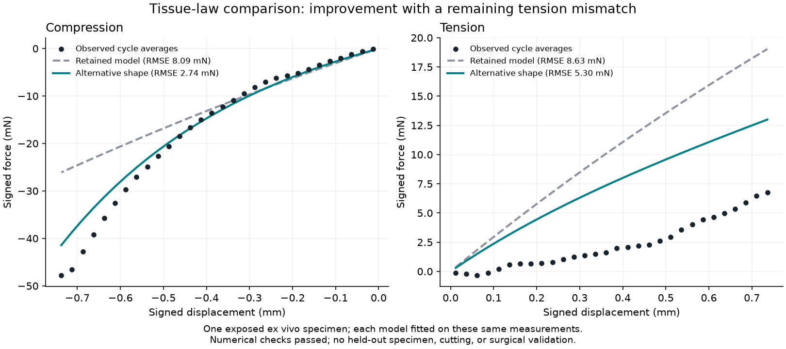

Generated by plot-comparison.py from the exact archived execution/comparison.json (SHA256 72497329b4671f2569620ac848c019c9f902f6c346d03fc4879500c94284450b). The numerical and physical limitations are in RESULT.md. Black points are correlated processed observations from one exposed specimen. Both curves use parameters fitted to those same observations.
