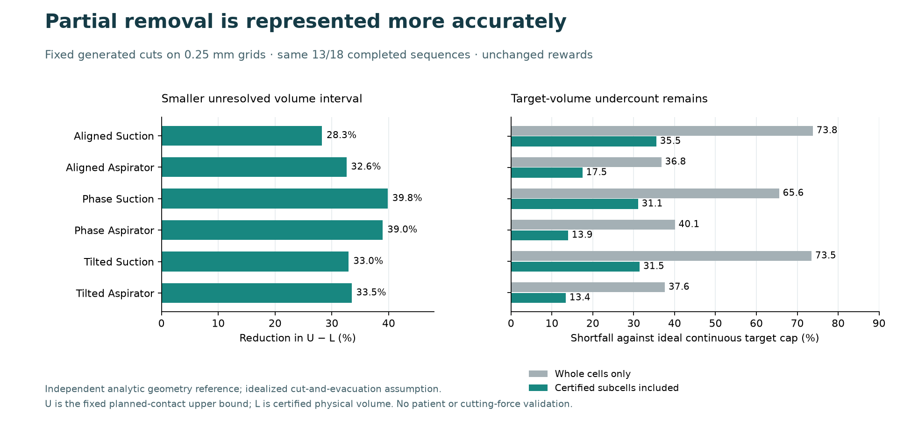

# Certified partial evacuation improves generated volume bounds

The new opt-in model tightens the conservative physical-volume interval by
**28.27–39.84% in all six 0.25 mm scenes**. It retains the same 13/18 completed
sequences, all old action/refusal outcomes and every reward. Keep this explicit
representation improvement; the default planner remains unchanged.

## Failure, change and fixed comparison

The retained union model certified cut-and-evacuated subcells, but its reported
removal counted only fully cleared parent voxels. Certified partial volume was
therefore missing. The new readout counts the union of executed certified leaves
and cleared parents exactly once. The target fraction in a parent does not locate
target inside its leaves, so cumulative target removal is an interval, not a
fraction-times-leaf point estimate. Source-support volume and evaluator-clipped
physical tissue volume are reported separately.

This compares the same two generic tools, three grid spacings, three samplings,
ten prescribed actions per scene, microsteps and reward against the retained
18-row union and original default baselines. Parent target mass comes only from
the same public float32 parent fractions, with outward rounding-bin bounds.
Only the separate evaluator knows the analytic tissue/target planes. Shaft
occupancy, actual actions, labels and whole-cell rewards stay unchanged.

With fixed planned-contact upper bound U and whole-cell physical lower bound L,
the primary outcome is the reduction in U−L after adding independently checked,
physically clipped partial evacuation. This does not claim the exact total
continuous cut-union volume. U includes prescribed but unexecuted suffix sweeps.

| 0.25 mm scene | Physical lower bound, old → new (mm³) | Smaller U−L | Target cap shortfall, old → new |
|---|---:|---:|---:|
| Aligned suction | 22.851563 → 27.078491 | 28.27% | 73.82% → 35.53% |
| Aligned aspirator | 95.867188 → 107.598633 | 32.57% | 36.77% → 17.46% |
| Half-phase suction | 21.625000 → 27.675049 | 39.84% | 65.57% → 31.07% |
| Half-phase aspirator | 94.062500 → 107.970459 | 38.97% | 40.07% → 13.95% |
| Tilted suction | 22.164062 → 27.218107 | 32.97% | 73.48% → 31.45% |
| Tilted aspirator | 94.992187 → 107.455559 | 33.49% | 37.62% → 13.39% |

All other rows also preserve or increase the lower bound without crossing U.
Every independently clipped target intersection lies inside its declared mass
interval and below the analytic cap. More accurate target readout is not an actor
success or extra reward. All 180 slots are retained: 141 accepted, five refused,
34 unexecuted suffix actions, and 146 actual native calls. All 15 nonempty
histories pass the separate geometric checker; three empty prefixes have no
invented certificate. The same two additional completions over the original
11/18 default remain; this readout change adds no completion itself.

## Independent validation and preserved reporting failure

The source integration passed 168 focused controls, including a complete coarse
scene, plus 12 independent clipping controls. The independent saved-result audit
passes 41,187 checks and recomputes the 15 checked sparse final geometries using
separate face clipping. It checks source/history/geometry bindings, target-mass
enclosures, coherent cumulative intervals, counts and all comparison metrics.
These are generated engineering checks, not independent clinical observations.

The original full run completed, but its automated useful-result flag was false:
the in-memory comparison rejected NumPy float scalars against JSON floats in
five refused-action endpoints. All 18 stored legacy projection hashes and their
serialized values are exactly equal. The original report and false flag remain
unchanged. Six focused regression tests pass; the separate
[saved-only correction](runner-repair/saved-parity-correction.json) requires exact
canonical equality, applies only corrected parity flags to a copy, and then
passes the original criterion. No reward, geometry, threshold or denominator was
changed, and no native experiment was repeated. The independent audit reaches
the same conclusion separately.

The reviewer's first saved audit stopped under an older system Python lacking
`int.bit_count`. Its original failure is retained. The unchanged audit passes
under the experiment's `.venv` Python.

## Cost and limits

One native matrix: **96.422 s parent / 95.437 s worker**, including 54.761 s native
work and 37.718 s independent checks plus clipping. Peak sampled resident memory
was 528,400,384 bytes. The child was reaped with no cleanup errors or survivors.
Attempted geometry work stays exactly 68,307,262 leaf tests and 219,045 witness
rows. The independent saved audit adds 2.763 s, including 2.668 s clipping. Six
repair controls take 0.16 s. Report comparisons with the previous 99.417 s worker
are descriptive, not a paired speed measurement; the new run also includes the
previously committed digest-cache optimization.

The 14:01:03 UTC storage closure attributes **5.676 MiB** additional allocated
growth to this iteration within its 24 MiB allowance. Total extension growth is
1.635 GiB with 331.228 GiB free. It includes retained local geometry, the compact
archive and plot/cache output; later snapshot-copy/documentation/commit writes
are outside that timestamp. No new dataset or dependency was acquired.

This experiment uses generated geometry and an assumed cut-and-evacuation model.
There is no new patient, force measurement, learning update, held-out evaluation,
policy win or clinical safety evidence. Parent target intervals describe supplied
mass uncertainty, not validated segmentation uncertainty. The source-grid obstacle
still conservatively occupies a whole parent until it clears completely.

The next specific model bottleneck is remaining target undercredit: 31.07–35.53%
for suction and 13.39–17.46% for the aspirator. Before changing collision rules or
launching training, distinguish finite subcell containment from the whole-parent
exposure/clearance restriction on one retained fine-grid scene. Any subsequent
use of partial cavities for clearance needs independent residual-tissue checks.
The separate unresolved tensile-force measurement dependency also remains open.

## Provenance and reproduction

- Tested canonical source: commit `52b2a62` (author skamal23, co-author shafsthegoat).
- Frozen source index: `c625f7c69e1cfa2bb2dbd7fc4051c6fa20c3a24bc75c623006ebabf1fb952263`.
- Original report: `c9265daaf186b025403ee499a333f0e2811feab66f65e10a98a3d97f17300ee9`.
- Additive parity correction: `1d9c5d364b0aa07847eaaad06a10c7c850f7f71413226e8c4cc4151caedbe1e8`.
- Independent successful audit: `b881c0aee0f2af8046fe3e24f2500c894eb9e377e97ccbe34e5997a63e02016b`.

This archive retains one full scalar/per-action report, compact controls, original
negatives, runner/evaluator source and the inspected plot. The independent
reviewer's manifest excludes its own duplicate report; the root archive includes
that report once in `run-01/`. Bulk sparse geometry stays local under
`build/native-partial-volume-v1/run-01/geometry/`, with all hashes and sizes in
the independent manifest. It is needed for saved geometry re-evaluation; the
generated experiment can also reproduce it. No patient data or weights are in
this archive. See [reproduction instructions](REPRODUCE.md).
