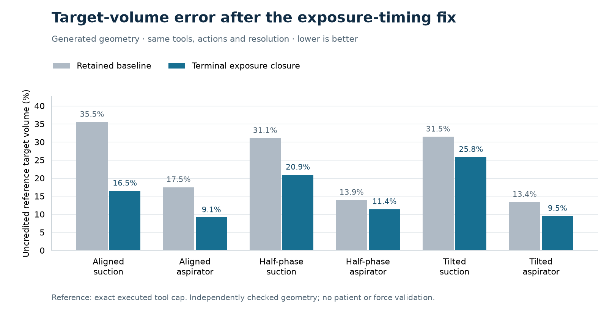

# Terminal exposure closure reduces generated cutting-volume error

The optional terminal-only closure model reduces target-volume undercount in
all six fine-grid scenes by **17.87–53.59% relative to the retained error**.
All 13 baseline complete sequences remain complete; none hits a preview-work
limit. Independent saved evaluation passes 37,966 checks. This is an improvement
in the numerical representation of idealized cut-and-evacuate actions, with
**no change in whole-cell rewards or planning outcomes**.

The worker completed, but its parent supervisor failed an RSS/cleanup check.
The scientific result and failed supervision are recorded separately. The
original launcher remains `incomplete_or_failed`; this is not a clean accepted
resource run, a speed win, or validation of physical cutting. Retain the optional
model and its negative predecessors; do not replace the default planner on the
strength of this result alone.

## Failure, cause and targeted changes

The saved aligned-suction baseline undercounted the exact executed target cap by
0.154799 mm³. Independent containment analysis separated 36.35% of this residual
into finite-leaf boundary loss and 63.65% into contained but uncertified volume.
Some parents only became exposed after other parents were cleared during the
same executed capsule. Final-state adjacency alone does not establish original
microstep exposure timing.

The first change (`bc78bbb`) closes this same-capsule exposure dependency after
complete parents become clear. Its complete 18-scene result is **negative**:
two fine-grid aspirator first actions reach the unchanged 8,192-witness limit,
reducing completed sequences from 13 to 11. Four fine-grid target estimates
improve. All 21,571 independent saved checks pass, including the negative gate.
Fewer executed actions explain the lower elapsed time; it is not a speed gain.

The second change (`7ed4ef8`) applies closure only in the actual terminal
microstep. Intermediate steps retain the original exposure rule. It neither
changes limits nor depends on target labels. The checker independently derives
terminal position from the concrete executed history and requires rooted,
fully cleared parent support for every newly certified leaf. No partial-cell
channel, future cut, or unexecuted suffix supplies clearance.

## Fixed comparison and results

The primary baseline is the existing partial-volume result at `b16ffec`.
The same 18 generated scenes, two generic tools, three grid placements, three
resolutions and 180 planned action slots are retained. Depth, actions, prior
cavity shaft checks, rewards, target-mass semantics and work limits are fixed.
Success was predefined: preserve all 13 completions, pass all nonempty geometry
checks and bounds, avoid budget refusals, and improve at least one of six
fine-grid target volumes without regression in any of them (1e-8 mm³ tolerance).
The all-capsule failure is only a secondary reference.

| Fine-grid scene (0.25 mm) | Baseline target, mm³ | Terminal closure, mm³ | Baseline undercount | New undercount | Error reduction |
|---|---:|---:|---:|---:|---:|
| Aligned suction | 0.280835 | 0.363794 | 35.534% | 16.491% | 53.59% |
| Aligned aspirator | 4.183350 | 4.606445 | 17.463% | 9.115% | 47.80% |
| Half-phase suction | 0.300269 | 0.344458 | 31.073% | 20.930% | 32.64% |
| Half-phase aspirator | 4.361401 | 4.491528 | 13.950% | 11.382% | 18.40% |
| Tilted suction | 0.298612 | 0.323095 | 31.454% | 25.833% | 17.87% |
| Tilted aspirator | 4.389846 | 4.586014 | 13.389% | 9.518% | 28.91% |

Undercount is relative to the analytic cap of the **executed** final tool stroke:
0.4356341813 mm³ for suction and 5.0684361478 mm³ for aspirator. The cap is zero
where that stroke never committed. These are evaluator references, not patient
labels or deployment inputs. The source target-fraction intervals contain all
independently clipped target volumes. All 18 whole-parent counts, whole-parent
target volumes and total rewards exactly equal the primary baseline.

## Independent evidence and cost

- **233 source/regression controls pass** in 5.04 seconds, including default and
  predecessor parity, false bridges, early/future exposure, shaft collision and
  atomic budget rollback. Earlier invalid-fixture failures are retained.
- **15 nonempty geometry certificates pass**; three empty histories are N/A.
  A separate saved-only evaluator reclips every certified geometry using
  independent plane arithmetic and reproduces the unchanged useful criterion.
  Its 37,966 checks take 3.393 seconds and execute no native actions.
- The terminal matrix accounts for 141 accepted actions, 5 geometric refusals
  and 34 unexecuted suffix slots. All 146 attempted native calls return, with
  56.052 seconds native time, 36.765 seconds history checking and 2.898 seconds
  plane evaluation. Worker time is 99.418 seconds; parent time is 100.206 seconds.
- Recorded peak RSS is 528,400,384 bytes (503.922 MiB); output before the launcher
  receipt is 3,716,270 bytes. Caps remain one thread, 2 GiB sampled RSS, 8 MiB
  output, 240/250 seconds, 180 calls, depth 3 and 8,192 witnesses per preview.
  These sampled observations do not resolve the monitoring failure below.
- The two earlier exposure attempts used another 139 calls. All three attempts
  total **285 native calls / 94.871 seconds native time**, excluding the retained
  earlier baseline cost and source tests. No fitting, RL updates, weights,
  patient reads or dataset downloads occurred. Historical timing is unpaired.

The original short attempt stopped after 11 calls because a monitor saw an
atomic writer temporary disappear. A narrowly tested prospective repair retains
strict final checks; both original files and failed receipt are preserved.

The terminal worker exits zero and writes its complete report. The parent
records 483 RSS samples, `live_group_rss_unknown`, cleanup `Operation not
permitted`, a reaped child and no remaining owned PIDs. The receipt does not
identify the missing-sample PID or failing cleanup operation. An exit race is a
plausible explanation, not established evidence. The independent audit status
is `PASS_SAVED_SCIENCE_SUPERVISION_FAILED`; no receipt is relabeled and no full
matrix is repeated merely to obtain a green supervisor status.

## Scope and next bottleneck

No specimen or intraoperative measurement agrees with these cutting numbers:
the independent reference is mathematical geometry. Cutting forces, deformation,
injury, living-brain material properties and clinical safety remain unsupported.
Generic research tools and automatic withdrawal remain explicit assumptions.
Patient partitions are unchanged: exposed SELECT013 and TRAIN050 remain
development; SELECT037 and final EVAL067 remain reserved under existing rules.

The next model question is whether a planner using the public partial-volume
state chooses a better complete sequence under a frozen objective and the same
information/budget. The current whole-cell reward and conservative shaft model
do not consume this accuracy gain. Test that decision consequence before another
training sweep or resolution increase. Supervision also needs a prospective
exit/identity-aware correction before the next owned experiment; the saved
scientific result does not waive it.

A prospective correction is now prepared and verified separately: 11 controlled
lifecycle cases pass, and one benign real Darwin child completes its live RSS
sample, exit between samples and membership-only cleanup in 0.018 seconds.
The helper accepts a missing sample only after a bounded wait confirms the
exact child's exit. Unknown live memory, EPERM and unverifiable ownership still
fail. It records phase/PID/identity evidence, and does not probe a reaped child's
RSS or signal its old group. The full numerical launcher has not yet exercised
this helper; the original failure remains unchanged. Source and both root
receipts are bound in `MONITOR_REPAIR_INDEX.json`.

The compact archive is below its 3 MiB allowance; raw sparse geometry remains
in one local location with hashes in `ARCHIVE_INDEX.json`. The whole iteration
uses the coordinated 16 MiB reservation and no additional acquisition.
The dated extension-wide storage closure is in
[the storage ledger archive](../local-storage-extension-v1/README.md).

## Exact evidence

- Terminal report: `d3f20430fea84bead52156122c43e6bde40bebb229d5983e808c6e175579a8db`.
- Original failed terminal launcher: `6b4048c294821f7bccb29d7219e5a3d705acfa6c0375099cc356b65ac594733c`.
- Executed terminal source index: `8b16ea13c6936fcd6051d1de5255db5565e9d8aa0b4c1c4e91d2dc199abd36d9`.
- Independent terminal audit: `d1b94af6cb27e12e5b7687038060c4cd97530c13b2fef39456b44888c7372d01`.
- Complete negative all-capsule report: `2ff4b774c1fde080fbf0e6854a7b48a85ec4417590347df2191f8a893ff38077`.

See `ARCHIVE_INDEX.json`, `terminal-validation/RESULT.txt` and
[reproduction notes](REPRODUCE.md) for source, provenance and local proof pointers.
