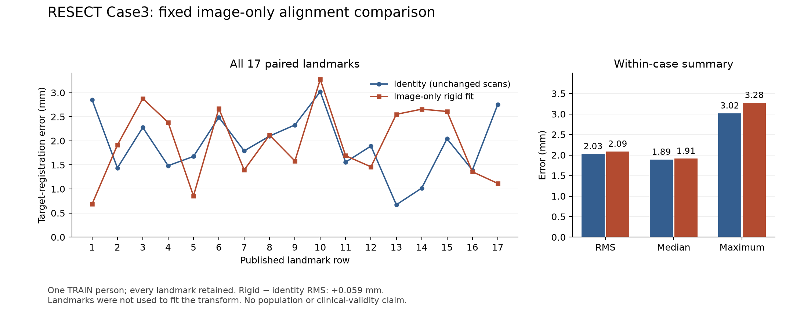

# Image-only rigid fitting did not improve Case3 landmark alignment

The fixed image-only fit improves image similarity but increases the primary
landmark error on one existing RESECT TRAIN person. All 17 published full-tag
pairs are retained at equal weight. Identity remains the comparison baseline;
the rigid candidate is preserved and not promoted.

| Fixed method | All-point RMS (mm) | Median (mm) | Maximum (mm) |
| --- | ---: | ---: | ---: |
| Physical identity (unchanged scans) | 2.028542 | 1.891915 | 3.019541 |
| Image-only rigid fit | 2.087485 | 1.913277 | 3.275634 |

The predeclared primary difference, rigid minus identity RMS, is
**+0.058944 mm**. Seven point errors decrease and ten increase. No point is
excluded, repeated or outside any of the four declared native-image checks
(before, during, identity-predicted during, rigid-predicted during). Bounds
checks establish geometric inclusion only, not image quality or anatomy.

The [exact scalar result](scalar-results.json), SHA256
`1794a37ad11861f7ee96bc738b4806f47674fc4b9000c15b673396de98b9cc06`,
and [execution accounting](evaluation-record.json) retain the negative result.
Full coordinates remain outside Git under the separately pinned output path.
The [corrected ROOT release](root-evaluation-release-v2.json) follows format-only
preparation commit `1810a33`; it does not permit another registration fit.

These are sparse observations within one TRAIN person. There is no population
confidence interval, clinical threshold, dense-deformation, causal tool-action,
tissue-law or neurological-outcome claim. Case3's exposed full-tag points are
consumed development evidence for future work. Protected cohort roles and
payloads are unchanged.

The [independent actual-score audit](../resect-case3-evaluation-independent-v1/independent-score-qa.json)
passes after the outputs are frozen (SHA256
`e59808143c01bfea2b492ec2f4153dee67faea9044771d93662199b46040d661`).
Its separately frozen Decimal/shlex parser and standard-library arithmetic
reconstruct every point, prediction, native voxel, inclusion flag, duplicate
marker and scalar. Agreement is within the fixed 1e-9 absolute / 1e-11 relative
software tolerance. It rechecks source bytes and all release/output pins before
and after, without image decoding or refitting. Thirty prospective generated
checks and 18 wrapper controls pass. Numerical agreement verifies the reported
comparison; it does not establish anatomical or clinical acceptance.

The [creator's instructions](https://yimingxiao.weebly.com/data-repositories.html)
and [full methods](https://users.encs.concordia.ca/~hrivaz/Xiao_Database_MedPhys.pdf)
support reference-first landmark pairs in millimeter world coordinates and
matching MINC/NIfTI world frames. They do not supply this case's per-tool forces,
action times, effective ultrasound resolution or a clinical error tolerance.

## Frozen fit and retained preparation history

The single predeclared RESECT Case3 fit completed from preparation commit
`fa44c9e`. It uses only the two existing TRAIN ultrasound images and
image-derived signal/coverage support. The full-tag landmark coordinates were
unopened when the fit and scoring preparation were committed as `21e7b1b`.
No new person, acquisition, neural training or accepted
anatomy is added.

The [fit record](fit-record.json), SHA256
`35519def02baac35797076b33eabf2eb77dcf1b2314977c8c7eec642fb9e599d`,
binds the candidate, frozen transform, source checks and supervision. Full
matrices and the candidate remain under
`outputs/poc-resect-case3-image-registration-v1/`, outside Git. The frozen
transform SHA256 is
`e6648339d69841985f8fa644ae5d69168422ce12ca5dadc4659b275a8b9cd8af`.

The [supervision record](fit-supervision.json) reports exit zero, 1.301515 s
worker wall time, 1,590,722,560 sampled worker/family RSS bytes and at least
6,302,629,888 available bytes. Seven samples use the fixed 0.2-second interval;
the 4 GiB sampled stop and 240-second worker limit do not fire. The worker is
reaped and cleanup attempted. Sampling is not an exact memory peak or OS hard
limit. The optimizer phase alone takes 0.021308 s; these are single executions,
not comparative latency measurements.

Matched image NMI rises from 1.069655 to 1.078429 over 9,052 paired coarse-grid
voxels, with full declared overlap retained. No predefined image-QC flag fires.
This measures image similarity, not anatomical alignment. The subsequent fixed
stage compares identity and the frozen rigid transform against every published
full-tag landmark, without refitting, case replacement or outcome-based
exclusion. The measured result is above.

The [independent saved-fit audit](../resect-case3-registration-result-independent-v1/independent-fit-qa.json)
passes 24 generated/tamper controls and checks the actual saved hash chain,
runtime/source bytes, rigid inverse, direction, optimizer events and supervision.
It does not decode images or independently recompute the image objective. Its
report SHA256 is
`3277460d1529126ea04828e8785ffd0ebfebdc1ae6209b77e7d4cd92eed1a955`.
The separate [scoring preparation](../resect-case3-registration-evaluation-preparation-v1/preparation.json)
fixes all-point Euclidean TRE, native-image inclusion reporting, duplicate
retention and the rigid-minus-identity RMS endpoint. Its 52 generated controls
pass before actual landmark access. The scorer and fit records are committed
before the separate evaluation release; preparation is not an accuracy result.

Both acquired source files are rechecked after decoding and after fitting;
code/runtime continuity and transform/inverse/direction are checked before the
freeze. The [separate root release](root-fit-release.json) grants exactly one
fit on the fixed outputs path. An unused initial release is retained after its
ambiguous model-fitting category was replaced with explicit neural-training
and registration-fitting fields, before any worker started. Scientific inputs
and settings are unchanged; there is one actual fit attempt and no retry.

The earlier [independent preflight](../resect-case3-registration-preflight-independent-v1/independent-qa.json)
and its exact generated-auditor snapshot are preserved. That audit is software,
source/header and runtime evidence. Sparse landmark scoring, effective imaging
resolution, scanner/tracker calibration, dense deformation, tool causality and
clinical validity remain separate questions.

The first separately released scoring invocation then read the exact full tag
and refused its syntax before computing accuracy. All 17 rows carry an empty
quoted MINC label after their six numeric fields; the original reader required
exactly six tokens. The [refusal](initial-evaluation-refusal.json) and
[format diagnosis](../resect-case3-registration-evaluation-preparation-v2/diagnosis.json)
remain preserved. A minimal format correction accepts that optional empty label;
64 generated controls pass. Transform, statistics, inclusion, duplicate retention
and all scientific settings are unchanged. The separate
[v2 preparation](../resect-case3-registration-evaluation-preparation-v2/preparation.json)
discloses this prior tag exposure. Corrected scoring was pending at commit
`1810a33`, before the second ROOT release and the one completed comparison
reported above. There is one fit, one syntax refusal, one completed all-point
comparison and no refit or outcome-based selection.
