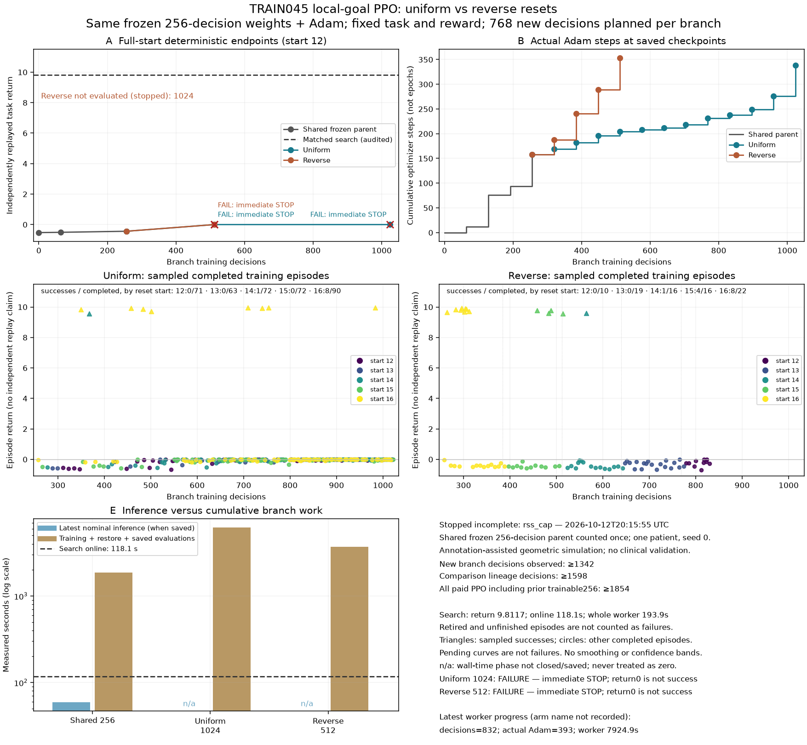

# Reset-curriculum run stopped at its memory limit

On October 12 the owner supervisor stopped the worker at its declared 4 GiB RSS
limit. Peak sampled group RSS was 4,296,671,232 bytes, 1,703,936 bytes above the
4,294,967,296-byte ceiling. The parent ran for 7,927.260823 seconds and reaped the
worker after SIGTERM; lifecycle verification records no errors or surviving
owned processes. The worker log is empty. This is an incomplete campaign, not a
completed negative reverse1024 result.

## Results that remain usable

Uniform512, uniform1024 and reverse512 remain saved, independently replayed
checkpoints and evaluations: each immediately STOPs at the full-task start,
return zero, goal false. Retained search completes the same task in five
preparation/goal actions with return 9.811680 and zero outside-target removal.
The earlier [comparison record](../train045-local-goal-curriculum-result-v1/RESULT.md)
contains those checkpoint hashes and their measured costs. No reverse1024
checkpoint or evaluation was produced.

The last durable progress record reaches reverse 832 decisions and 393 actual
Adam updates. It is a lower bound on work before termination, not a saved model.
The latest restorable reverse checkpoint is 512, with 353 Adam updates. At least
320 subsequent decisions and40 updates were paid but are not recoverable from
that checkpoint; additional work after the progress write is unknown.

The saved reverse episode files contain 83 completed episodes and 574 new
policy decisions, with 13 sampled successes:

| Reset start | Completed episodes | Sampled successes | Decisions in completed episodes |
| --- | ---: | ---: | ---: |
|16|22|8|132|
|15|16|4|126|
|14|16|1|129|
|13|19|0|131|
|12|10|0|56|

The last progress counter reports 576 new decisions: 574 completed-episode
rows plus 2 live decisions not saved as a completed episode. Neither unfinished
decision is converted into a failed episode. Compared with reverse512, 46 more
episodes complete, with two more near-goal successes and none at full start12.
Saved reverse episodes cover 471 distinct native states and 550 state/action
pairs. These counts describe one reused TRAIN045 simulator task; they are not
new patients or clinical evidence.

## Paid work and verification

The attempt's last durable counters are **at least 164,357 native previews and
1,436 transitions**, all completed at that write. The progress wall time is
7,924.884891 seconds; the parent's 7,927.260823 seconds includes the subsequent
termination interval. The worker never finalized its phase ledger, so pure
inference and final worker totals are not fabricated. Pilot, PPO256 and this
attempt together cost 11,842.068666 parent seconds, with at least 252,029 previews
and 2,226 transitions, excluding separately retained qualification and search.

The terminal launcher binds the preserved report and frozen source index. The
report still says `running` and `source_unchanged: false`, because termination
preceded its final write. A separate post-termination SHA256 check verifies all
192 declared source files, with zero mismatches. This is explicitly a later
source-byte check, not an invented successful worker receipt. An independent
agent checked the terminal reason, checkpoint/episode bindings, missing endpoint,
source hashes and lower-bound accounting without loading models or running the
native simulator.

The renderer now uses the terminal supervisor status when the worker report is
stale. Missing reverse1024 is labeled not evaluated; no synthetic endpoint is
added. `INVENTORY.json` binds the immutable failure records, original policy
source and scalar plots. Weights, anatomy arrays and bulk trajectories remain
local and outside Git.

## Recovery decision

Retain search and the completed uniform branch. Test one memory-only change:
construct the identical eighteen-channel CNN input without three transient
float copies. The assembly currently has about 72 MiB of avoidable input
operands at batch 4/64³. This is source evidence of an allocation opportunity,
not proof of the sampled peak's cause or a measured RSS improvement.

Recovery will restore the exact reverse512 weights and Adam, run 512 new
PPO decisions with the original reverse schedule offset 256 (starts14→13→12),
and independently evaluate the 1024 checkpoint. Reset/RNG continuity was not
saved, so this is a fresh episode/RNG recovery, not seamless continuation. Its
six unfinished checkpoint decisions must be retired explicitly; the failed
post-checkpoint work remains charged separately. The same 4 GiB limit, batch
size, observations, rewards, legal actions and evaluation rules remain in force.
The prepared imitation branch remains unreleased until the recovered comparison
has an independently checked terminal result. No model gain is claimed here.
