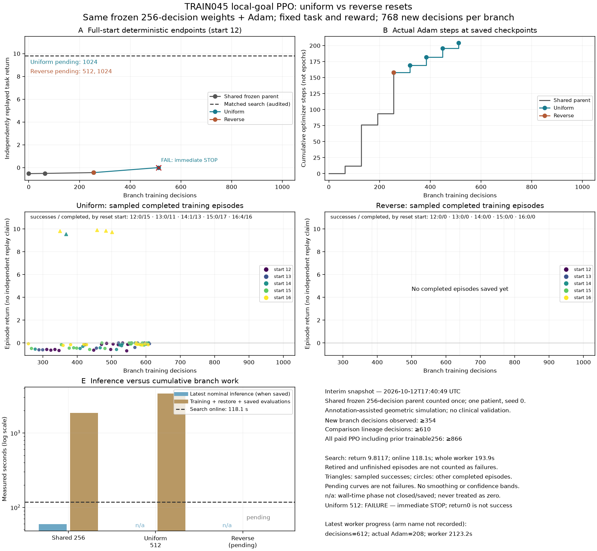

# Reset-curriculum PPO comparison: uniform1024 and reverse512

**Completed uniform branch, October 12: more training did not improve full-task
performance.** Both the 512 and 1024 checkpoints stop immediately, returning zero
and failing the goal. Retained search succeeds in five preparation/goal actions,
with return 9.811680 and zero outside-target removal. The reverse-reset branch
started from the same original 256 checkpoint. Its completed 512 evaluation
also stops immediately. The run later [stopped at its memory limit](../train045-local-goal-curriculum-interruption-v1/RESULT.md) at reverse832; reverse1024 was not evaluated. Recovery is being prepared; the original campaign is incomplete.



The fixed task, information, reward, starts and resource limits are recorded in
[the prospective source archive](../train045-local-goal-curriculum-source-v1/README.md).
This is one exposed TRAIN045 geometric simulation using supplied/estimated
anatomy, not observed surgery, physical validation or evidence of generalization.
Search uses charged model queries under the retained protocol; it does not share
PPO's exact feature representation. Final patient evaluation remains closed.

## Reverse512 midpoint

The staged reverse curriculum adds 256 decisions and 195 actual Adam updates,
versus 46 updates for uniform at the same decision budget. Its full-start route
still consists of the inherited twelve-action prefix followed by STOP: goal
false, local return zero, no new target or outside removal. The compressed
plan/history and semantic seals are identical to uniform512/1024. The independent
review verified the checkpoint, fresh complete geometry, local reward and
evaluation isolation from saved records without executing another model.

The 37 new completed practice episodes contain eleven sampled successes:
eight from start 16 and three from start 15. All eight start-16 successes occur
in the first rollout, before a new optimizer update. This is more positive
training exposure, not itself evidence of learning. The schedule has not yet
reached starts 12–14; the midpoint is a transfer check, not the final verdict
on the completed curriculum. Natural episode boundaries produce 132 decisions
from start 16 and 124 from start 15, rather than forcibly truncating at 128.

The segment observes 205 distinct states and 242 state/action pairs on the same
one patient, with 38 resets. Shared-lineage totals are 512 decisions and 353
Adam updates; 494 completed-episode decisions + 12 retired unfinished + 6 live
unfinished decisions account for all 512. The four new rollouts apply
30/53/48/64 optimizer steps, yet the full-start outcome remains unchanged.
The encoder stays frozen.

The local checkpoint is
`build/train045-local-goal-ppo-v1/curriculum-1024-01/reverse-seed0/ppo-0512.zip`:
248,968 bytes, SHA256
`18794e285ae2b7d6219fe297bcf5a6e9d060c46710b822f6c3dc2575e5fbac47`.
Segment cost is 1,836.670 seconds, 320.914 seconds more than uniform512.
Training catalogue construction takes 1,555.157 seconds. The endpoint's combined
evaluation/replay/audit/isolation costs 29.493 seconds, including one catalogue
at 3.778 seconds; neither is a substitute for pending pure inference timing.
RNG, mode, optimizer and training-state isolation pass, and training resumes.
The exact reverse512 report and curve snapshots are preserved separately from
the growing live files. No whole-campaign terminal receipt is claimed yet.

## Uniform1024 result

The completed branch adds 768 decisions and 180 actual Adam updates over 71.755
minutes. It produces 368 completed episodes, with nine sampled successes:
eight from start 16, one from start 14, and none from starts 12/13/15. Of those
368 episodes, 237 immediately STOP; their mean length is only 2.08 decisions.
A higher episode count does not establish broader or more successful experience.

| Quantity | New uniform segment | Shared-parent lineage |
| --- | ---: | ---: |
| Policy decisions | 768 | 1,024 |
| Actual completed Adam updates | 180 | 338 |
| Completed episodes | 368 | 394 |
| Successful sampled episodes | 9 | 13 |
| Distinct native source states | 356 | 541 |
| Distinct state/action pairs | 480 | 690 |
| Unique patients | 1 reused | 1 |

The lineage partition is exact: 1,010 completed-episode decisions + 12 retired
unfinished decisions + 2 live unfinished decisions = 1,024. The full-start
evaluation again consists of the exact twelve-action reference prefix plus STOP;
its sealed plan and history are byte-identical to the 512 artifacts. The fresh
replay, full-tool geometry and reconstructed zero local reward agree. The
independent evaluator checked these bindings, checkpoint bytes, unchanged
encoder, episode counts and actual optimizer hooks without loading a model or
rerunning the simulation. No goal, movement or removal was added by the policy.

The local checkpoint is
`build/train045-local-goal-ppo-v1/curriculum-1024-01/uniform-seed0/ppo-1024.zip`:
248,905 bytes, SHA256
`4da71a4fd678e88cfc1c5e8929fcff397b976f1045abf80b05f6629e856c8e07`.
New-branch wall time is 4,305.319 seconds; shared-lineage wall is 6,159.952 seconds.
The final evaluation/replay/audit/isolation costs 28.277 seconds, including 3.916
seconds constructing its single catalogue. Pure nominal inference timing awaits
the final campaign report and is not replaced by either partial cost.

Saved optimizer traces narrow, but do not settle, the learning diagnosis.
The 256→512 segment performs 11/13/14/8 Adam steps per 64-decision rollout, each
short of its first 16-minibatch pass because PPO stops on excessive minibatch KL.
The 512→1024 segment performs 4/4/6/13/7/11/27/62 steps. Its last update therefore
spans almost all four planned epochs. Greater update coverage does not produce
goal completion here; insufficient update count alone is not an explanation.
Near-zero logged behavior-value explained variance does not establish the final
critic's quality or a representation-capacity limit. Rewards, masks, world and
evaluation remained fixed; the pending reverse branch tests the reset schedule.

## Earlier 512 checkpoint

The uniform branch resumes the exact frozen-encoder PPO256 weights and Adam
state. At its saved midpoint:

| Quantity | New segment | Shared-parent lineage |
| --- | ---: | ---: |
| Policy decisions | 256 | 512 |
| Actual completed Adam updates | 46 | 204 |
| Completed episodes | 35 | 61 |
| Successful sampled episodes | 5 | 9 |
| Distinct native source states | 219 | 409 |
| Distinct state/action pairs | 250 | 465 |
| Unique patients | 1 reused | 1 |

All five new sampled successes start closer to the goal: four at start 16 and
one at start 14; none at start 12, 13 or 15. They are saved training trajectories,
not independently replayed full-task successes. The lineage's 492 decisions in
completed episodes, 12 retired unfinished decisions and 8 live unfinished
decisions sum to 512. Unfinished episodes are not converted into failed episodes.
The reverse branch will share the same original 256 decisions; cross-branch
totals must count that parent once. The retained trainable-encoder256 baseline
and original imitation model remain separate.

The standard SB3 checkpoint, including optimizer state, remains local at
`build/train045-local-goal-ppo-v1/curriculum-1024-01/uniform-seed0/ppo-0512.zip`:
248,811 bytes, SHA256
`f299a593ff0a07cf1694e07410ccda020f3ee46b91f1231eebe2f1070346a24e`.
The encoder remains unchanged, as required by this reset-only comparison.

## Independent midpoint check and cost

The evaluator verified the exact inherited twelve-action prefix, the final STOP,
compressed artifact hashes, semantic plan/history seals, accepted full-tool
geometry and reconstructed local reward. The full history has thirteen rows and
the policy makes one STOP decision: no new movement, goal removal or outside
removal. Its initial native state, observation and action catalogue match the
retained search comparison. Available preparation actions were not removed from
the benchmark. The review used saved records; the worker had already performed
the fresh native replay and independent geometric evaluation.

Checkpoint hash, 204 completed optimizer hooks, unchanged encoder and decision
partitions were checked separately. The midpoint isolation receipt verifies
unchanged policy, optimizer, training summary, last observation and native state,
with random generators and policy mode restored. Subsequent saved progress at
561 decisions confirms training resumed. The running report's initial
`source_unchanged: false` is pending the final guard, not a terminal failure; no
terminal parent receipt exists yet.

The new segment through this checkpoint costs 1,515.756 seconds, including its
evaluation. Evaluation, replay, geometry and isolation together cost 25.434
seconds. The evaluated policy constructs one catalogue in 3.553 seconds; that
catalogue-only duration is not total inference latency. The live report has not
yet published final phase costs. Retained search costs 118.055 seconds online
and 194.241 parent seconds including replay/validation. A failed STOP policy
does not establish an acceptable speed advantage. Shared upstream model/teacher
preparation costs remain in the preceding campaign records.

The compact renderer reads only saved scalar reports and training-episode
records; it neither executes policies nor decodes checkpoints. The figure was
rendered and visually inspected. Endpoint points, sampled training returns,
actual optimizer steps and paid costs are separated. Its latest training rows
include the active reverse branch beyond saved endpoints; inputs are sequential snapshots with
their hashes retained in the JSON. Pending endpoints are not plotted as failures.
Rerun from the original runtime location:

```sh
.venv/bin/python -I -B build/train045-local-goal-ppo-v1/plots-curriculum-01/render_curves.py
```

The archived renderer preserves that script; it expects the original stage
layout. `INVENTORY.json` binds the preserved uniform512 and reverse512 snapshots,
completed uniform1024 report/curve, and updated renderer and plots.
Weights, anatomy arrays and bulk trajectories are not archived in Git.

## Decision still pending

Keep search as the working baseline. The failure persists through 1,024 decisions:
immediate abstention at the full-task start despite sampled successes near the goal. This
does not yet isolate representation capacity, optimization or sparse-credit
learning. Finish the frozen uniform/reverse comparison without changing rewards
or legal actions mid-run, then decide whether the curriculum improves complete
outcomes. No additional model sweep is launched alongside it.

After this compact snapshot, before final documentation/Git writes, measured
extension growth is 1,848,979,456 bytes (1.722 GiB), with 350,162,235,392 bytes
free (326.114 GiB), no reservation
overruns and no new dataset. Runtime artifacts remain within the existing
192 MiB stage reservation; compact archival writes use the existing root
bookkeeping reservation. Physical measurements continue as a separate evidence
stream.
