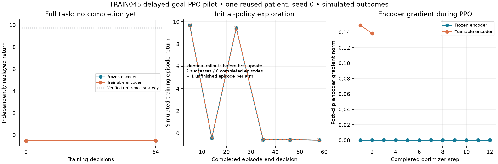

# Local-goal PPO pilot and matched search

The task is solvable, but the first PPO rollout does not produce complete-task success. Retain bounded search as the current decision baseline. Continue the unchanged campaign to 256 decisions per arm to obtain subsequent on-policy experience after the first updates; do not treat the pilot as substantial training or an encoder advantage.

| Method | Training decisions in this pilot | Actual optimizer steps | Full-task success | Return | Online planning seconds | Online previews |
|---|---:|---:|---|---:|---:|---:|
| Original IL64 initialization | 0 | 0 | No | -0.5275812721 | 55.127 / 56.075 | 1,396 each |
| PPO, frozen encoder | 64 | 12 | No | -0.5079000272 | 61.949 | 1,397 |
| PPO, trainable encoder | 64 | 2 | No | -0.5073469013 | 62.930 | 1,396 |
| Bounded informed search | 0 | 0 | Yes | 9.8116796752 | 118.055 | 2,712 |

All four learned endpoint routes and the search route pass fresh full-route replay, independent whole-tool geometry and separately reconstructed local reward. All have zero outside-supplied-target removal. This does not validate real tissue forces or neurological safety. Search has better completion; the faster failed learned routes are not an efficiency improvement.

## Frozen task and search

This is one already-exposed TRAIN045 anatomy and one declared local goal, after the same genuine twelve-action prefix. The goal and reward stay fixed, with a one-time bonus for actual simulated goal-cell removal and negative action, travel, switching and outside-target costs. Absolute horizon is 24. The qualified curriculum starts at steps 12–16; evaluation always starts at 12. Missing motor/language inputs remain unavailable. The original four-patient IL64 and other baselines remain unchanged; final patient evaluation remains closed.

Search keeps two live branches separately from terminal STOP, ranks every legal row, and commits the union of two best immediate local-reward and two current-blocker-overlap proposals. It completes its declared pruned search: 17 catalogs, 537 ranked rows, 45 evaluated children, 37 negative children and eight successful children. This is bounded informed search, not exhaustive or globally optimal. The winning route uses four costly suction preparations and a goal cut, then STOP; 38.320325 mm tool travel and zero switches give return 9.811680. The original independently qualified witness returned 9.738267. Reference future actions are not supplied to search.

Both methods use the same public world, legal actions, goal, reward and complete-tool constraints. Search spends additional queries on the public nominal transition model and current obstruction evidence; PPO receives raw observed image/coverage/availability, goal and action geometry without direct lookahead rewards. These are different algorithmic query capabilities, not equal forward-pass counts. Costs are measured on the same Mac, with the declared thread/cap differences preserved in the configurations; no universal speed or optimality claim follows.

## What training established

The controlled arms have identical initial full routes and identical initial 64-decision stochastic rollouts. Across both arms, 128 collected decisions contain only 62 unique native states and 64 unique native-state/action pairs. Each arm completes six episodes: two succeed from starts 16 and 14, four fail, and one six-decision episode remains unfinished. No start-12 episode succeeds. Both successful episodes occur before any optimizer update, with four and nine negative decisions preceding the bonus: delayed reward exists, but learned preparation credit is unproven.

Frozen-encoder parameters remain exact and their gradients zero. The learnable encoder receives gradients (post-clip norms 0.148961 and 0.138441) and changes its hash. PPO's per-minibatch KL guard stops the arms after 12 and two actual optimizer steps, before a complete first epoch. Logged mean KL is 0.019904 and 0.065006; this is not the stopping minibatch value. The shared pre-update critic explained variance of -0.006 is not a post-training accuracy result. Separate actor/value gradient contributions were not measured.

The frozen model's +0.019681 return change consists of one fewer tool switch offset by longer travel. The trainable model's further +0.000553 advantage is only 0.553126 mm less travel. Neither improvement completes the task. Learning stability and credit assignment remain the concrete questions for subsequent unchanged PPO cycles; the evidence does not establish that the frozen representation is insufficient.

## Checkpoints, costs and limits

The two standard SB3 checkpoints include optimizer state, occupy 248,122 and 282,004 bytes, and remain local. `EXPERIENCE.json` provides exact paths and hashes, unique-experience counts and inherited pretraining provenance. The original IL64 training used four TRAIN patients; this reused TRAIN045 task does not create a fifth. Its historical recorded attempt costs 723.747 seconds, 12,370 previews and 64 imitation updates, including its retained original deployment-audit failure. Earlier shared teacher preparation remains a separate upstream cost.

The current pilot costs 1,162.553 parent seconds, 32,575 previews and 302 transitions, sampled peak RSS 3,752,411,136 bytes. Actual training alone uses 7,576 previews per arm; the arm totals include initial and endpoint evaluation. Search costs 194.241 parent seconds, 6,748 previews and 96 transitions, sampled peak 999,718,912 bytes. Its planning phase alone takes 118.055 seconds; source/prefix reconstruction and independent replay remain charged separately. Earlier task qualification and its failed serialization attempt are retained in the qualification archive. Nested timing scopes are not summed as independent costs.

Eight generated PPO controls and five generated search controls pass. A separate read-only evaluator confirms matching initial trajectories, real encoder updates, unique-state denominators and the absence of full-task gains. These controls are not clinical validation. No new datasets, patient splits, world assumptions, rewards or physics parameters changed. Additional extension growth measured after these runs is 1,832,988,672 bytes (1.707 GiB), with 351,303,593,984 bytes free (327.177 GiB); later archive/Git writes are outside that dated measurement. Both child processes exited cleanly and were reaped. The next bounded continuation preserves optimizer state but restarts the genuine curriculum; it is not exact mid-episode continuation.
