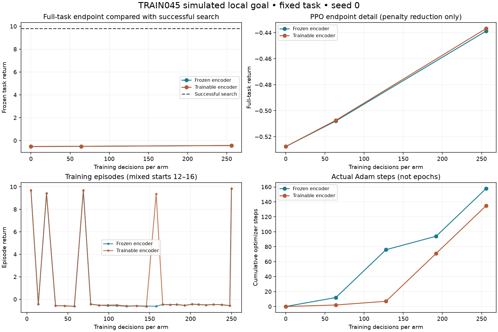

# PPO64 → PPO256: checkpoints improve penalties, not completion

**Decision: retain search.** Both actual MaskablePPO continuations finish, save loadable optimizer checkpoints and pass independent full-route geometry/reward replay. Neither deterministic checkpoint completes the fixed local goal. The trainable model encounters one full-start success during exploration, but does not reliably reproduce it. These are development results on one exposed TRAIN045 anatomy, not held-out generalization or clinical evidence.

| Method | Collected decisions per arm | Actual optimizer steps | Full-start completion | Return | Online planning seconds | Online previews |
|---|---:|---:|---|---:|---:|---:|
| Original IL64 | 0 | 0 new | No | -0.527581 | 55.127 / 56.075 | 1,396 |
| Frozen encoder PPO64 | 64 | 12 | No | -0.507900 | 61.949 | 1,397 |
| Trainable encoder PPO64 | 64 | 2 | No | -0.507347 | 62.930 | 1,396 |
| Frozen encoder PPO256 | 256 | 158 | No | -0.438688 | 59.202 | 1,421 |
| Trainable encoder PPO256 | 256 | 135 | No | -0.436734 | 59.966 | 1,414 |
| Retained bounded search | 0 | 0 | Yes, five actions | 9.811680 | 118.055 | 2,712 |

All evaluated routes have zero outside-supplied-target removal. Failed learned routes taking less planning time do not meet the success criterion. Search and PPO share the anatomy, goal, legal actions, rewards and complete-tool constraints. Search pays for nominal transition and current-obstruction queries; these are different algorithmic query capabilities, not identical per-decision features. Search is bounded and pruned, not globally optimal. Its full record remains in the [pilot/search result](../train045-local-goal-ppo-pilot-v1/RESULT.md).

## What the increased experience established

Each branch restores its exact PPO64 weights and Adam state, then collects 192 new decisions under the unchanged task and PPO settings. A fresh uniform reset over the five genuine states at steps 12–16 is explicit; this is not exact mid-episode or random-state continuation. Full-task evaluation remains at step 12. Frozen encoder weights remain unchanged; the learnable encoder changes with nonzero gradient norms. New optimizer steps are 146 and 133, including complete update cycles in both arms. Persistent KL stopping alone therefore does not explain the failure.

Each branch now has 256 decisions and 26 completed episodes. Frozen has four successful training episodes; trainable has five. Each retains six unfinished decisions from the previous process and six currently unfinished decisions, separately from completed episodes. Across both branches, 512 collected decisions contain **252 unique native states and 279 unique state/physical-action pairs**. Shared or repeated experience is not new patient diversity: the original IL64 pretraining used four TRAIN patients, including 045; the current task adds none.

The new trainable episode 9 starts from the full step-12 state and reaches the goal on its twelfth move, after eleven negative rewards. Its return is 9.376122, with five switches and 113.878160 mm travel, versus search's zero switches and 38.320325 mm. This saved training trace is not independently replayed and is not a successful checkpoint endpoint. It disproves the earlier absence of full-start successful experience, but cannot isolate an encoder advantage or demonstrate learned long-horizon credit.

Frozen PPO256's return gain over PPO64 is entirely two avoided switches and 9.212503 mm less travel. Its exact initial decision still clears none of the goal ray's current blockers; search's available useful preparation costs only 0.001953 more immediately. Goal-relative coordinates and current cavity observations are present. The CNN's spatial compression may limit useful local detail, but this result does not prove insufficient representation. Sparse successful preparation experience remains a testable bottleneck, rather than an established sole cause.

## Checkpoints, costs and next comparison

[EXPERIENCE.json](EXPERIENCE.json) records local checkpoint paths and exact hashes. Frozen/trainable standard SB3 archives occupy 248,752 / 292,807 bytes and include optimizer state; weights stay outside Git. The original models, patient splits and final evaluation remain preserved. The campaign source and seven generated continuation controls are retained in the [source archive](../train045-local-goal-ppo256-source-v1/README.md).

This continuation costs **2,752.255 seconds (45.87 minutes), 55,097 previews and 488 native transitions**, with 3,925,426,176 bytes sampled peak RSS. Adding the retained pilot gives 3,914.808 seconds and 87,672 previews for the progressive PPO runs, including their evaluations. Search costs another 194.241 seconds and 6,748 previews. Task qualification and historical imitation/teacher preparation remain separate upstream costs, documented in prior results. Nested timing scopes are not added together. Catalog construction dominates this local experiment; the result is not a cheap patient-adaptation claim.

The next controlled experiment compares uniform versus fixed reverse-reset practice, both starting from the same frozen PPO256 weights and Adam state, with 768 new decisions per branch and fresh full-start evaluations at totals 512 and 1,024. Only reset scheduling changes; rewards, world, policy, constraints and evaluation stay fixed. Natural episodes are never truncated to meet schedule boundaries. This tests whether more near-goal success improves complete-task learning without mixing in an encoder change. A negative result will retain search and guide a specific representation or optimization test. The learned encoder remains a preserved baseline.

No new dataset was acquired. The owner storage snapshot before this archive records 1,834,979,328 bytes additional extension growth (1.709 GiB) and 351,218,843,648 bytes free (327.098 GiB), with no reservation overrun. Archive/Git growth after that snapshot is additional. Geometry checks do not validate living-brain forces, injury thresholds or neurological outcomes; physical-measurement work remains separate.
