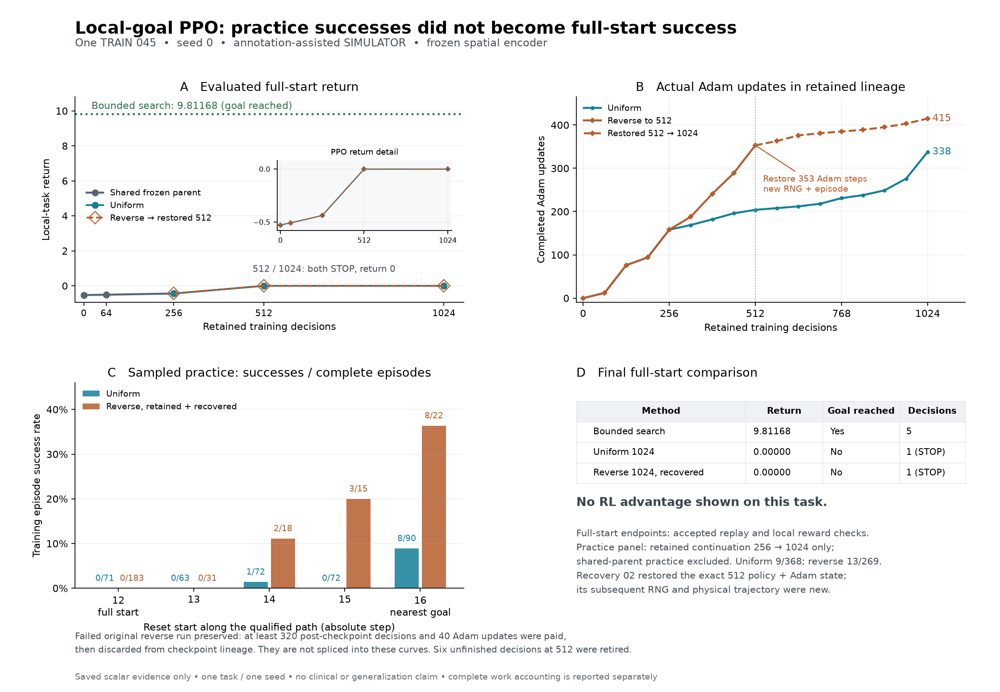

# Completed PPO curriculum comparison: retain search

The recovered reverse-curriculum model reaches its 1,024-decision checkpoint, passes independent replay, geometry and reward checks, and still immediately chooses STOP at the full starting position. Uniform practice gives the same failed outcome. **Retain search for this task; neither trained policy is promoted.**

This is one exposed TRAIN045 anatomy, one seed and an annotation-assisted geometric simulator task. The goal is a declared local removal target after useful preparation, not whole-tumor surgery. Final patient evaluation remains closed. These results do not validate tissue forces, neurological safety, surgical outcomes or generalization.

| Method and evaluated checkpoint | Goal completed | Local return | Policy/search decisions | Actual Adam updates in model lineage |
| --- | --- | ---: | ---: | ---: |
| Retained bounded search | Yes | 9.811680 | 5 | Not applicable |
| Uniform PPO, 1,024 | No: immediate STOP | 0 | 1 | 338 |
| Recovered reverse PPO, 1,024 | No: immediate STOP | 0 | 1 | 415 |

The task, available anatomy, legal actions, world, reward and full-start evaluation rules stay fixed. Search uses paid nominal-model queries; it does not use the identical internal representation as PPO. The reverse branch resumes its verified512 checkpoint with a fresh episode and RNG and a numerically checked memory-allocation change. It is not the interrupted trajectory continued seamlessly. The completed uniform branch is retained without rerunning it.

## What the additional training did

Recovery adds 512 decisions and 62 actual Adam updates. It completes 232 episodes: 18 from start 14 with two successes, 31 from start 13 with none, and 183 from full start 12 with none. Of these episodes, 146 immediately STOP, including 136 at the full start. All 512 new decisions are accounted for; the final reset has no executed decision. Practice successes are sampled simulator trajectories, distinct from independently replayed endpoint success.

The recovered model lineage has 1,024 decisions, 415 updates, 295 completed episodes, 622 distinct native states and 755 distinct state/action pairs. Its decision partition is 1,006 completed-episode decisions plus 18 retired unfinished decisions from earlier checkpoint boundaries. There is still only one patient. The saved comparison has 953 known distinct states and 1,202 known state/action pairs across retained lineages; the discarded failed tail is not included in that worker-reported union. The separate saved-record auditor also deduplicates the interrupted run's complete episodes, yielding lower bounds of 1,178 states and 1,468 state/action pairs across all paid saved experience. Unsaved tail work remains unknown.

All eight new rollouts log identical behavior-value estimates within each rollout, despite varying returns. Their optimizer update counts are 10/13/5/4/4/6/8/12. More updates and closer-goal successes did not transfer to a successful full-start decision sequence. Constant logged values provide a specific next diagnostic: examine input scaling and critic activations on differing allowed observations before another sweep. They do not establish a dead-activation cause, insufficient representational capacity, or the final checkpoint's critic accuracy.

## Checkpoint, verification and cost

The saved model, including optimizer state, remains local:
`build/train045-local-goal-ppo-v1/recovery-reverse1024-02/reverse-seed0/ppo-1024.zip`

It is 248,696 bytes; SHA-256 `f9dbf0b664fc67ce890e3ddc33f003145f996b2e45a497eb76470535a88aa8b6`. Weights and bulk training episodes are excluded from Git. Source index `615ac1221618abcf5f0c34998a29941766b694c3dfb5f74f784b3033cac64e3c` binds the [tested recovery implementation](../train045-local-goal-recovery-source-v2/README.md).

The worker replays the complete 13-row route from a fresh world and checks full-tool geometry and independently reconstructed local reward. The endpoint adds only STOP after the inherited 12-row prefix: no goal removal, movement or new outside-target removal. Policy/optimizer/training state and RNG isolation pass; the encoder remains frozen. Final source verification and clean owned-process termination pass. The [independent saved-record review](independent-audit/REPORT.txt) verifies 211 source hashes, checkpoint bytes, physical-history equality to uniform 1024, episode partitions, cost totals and the retained-search comparison without loading a model or running another simulation. The model does not judge its own route. This is independent checking within the declared simulator assumptions, not independent physical measurement.

New recovery costs 64,192 previews, 556 native transitions and 2,942.339 supervisor elapsed seconds (49.04 minutes). Sampled peak worker-group RSS is 3,940,679,680 bytes (3.670 GiB), and the worker-reported peak is 3,965,321,216 bytes; both remain below the unchanged 4 GiB limit. This confirms completion within the cap; it is not a controlled estimate of whole-run memory savings against the different interrupted process. Nominal endpoint planning costs 4.333 seconds plus 23.156 seconds for fresh replay/geometry. Search costs 118.055 seconds online and 194.241 supervisor seconds including checks. A faster failed STOP is not an acceptable planning-cost improvement.

Across the retained pilot/256 work, original interrupted curriculum, failed startup and this recovery: at least 2,368 collected PPO decisions, 770 actual optimizer updates, 318,705 previews, 2,807 native transitions and 14,827.013 recorded worker seconds. The interrupted tail contributes at least 320 decisions and 40 updates paid outside the restored checkpoint lineage. The shared frozen 256 parent is counted once; original teacher preparation, task qualification and search have separate preserved costs. The failed startup contributes zero PPO updates but its full measured cost. These are recorded runner-clock durations: this recovery's file timestamps span 7,413.541 seconds, longer than its supervisor clock; suspend/offline intervals are not separately measured.

The [post-campaign storage measurement](storage.json) records 1,862,426,624 additional resident bytes (1.735 GiB) and 351,139,717,120 free bytes (327.024 GiB), before final compact documentation/Git writes. No dataset was acquired. The unused training reservation was released after verified termination; all checkpoints and results remain preserved.

The completed campaign delivers a trained checkpoint, learning curves and a retained-search decision. The next bounded diagnostic should explain the unlearned preparation sequence and constant behavior-value estimates before increasing training experience again. Any next imitation or learning comparison requires its own frozen conditions; no further sweep was launched as part of this result.

The plots were rendered locally with `build/train045-local-goal-ppo-v1/plots-recovery-02/render_curves.py`; the archived renderer is an exact source snapshot and expects that retained local report tree. Its saved JSON contains the plotted scalars and source hashes.
